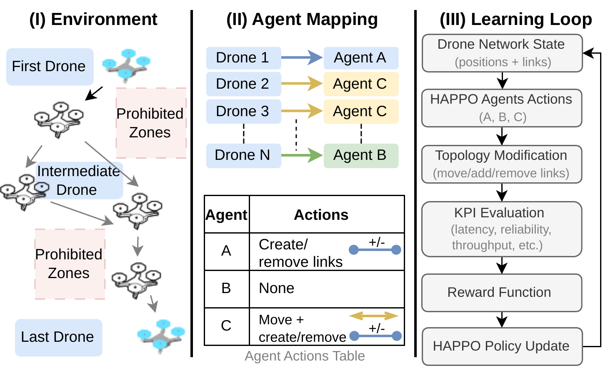
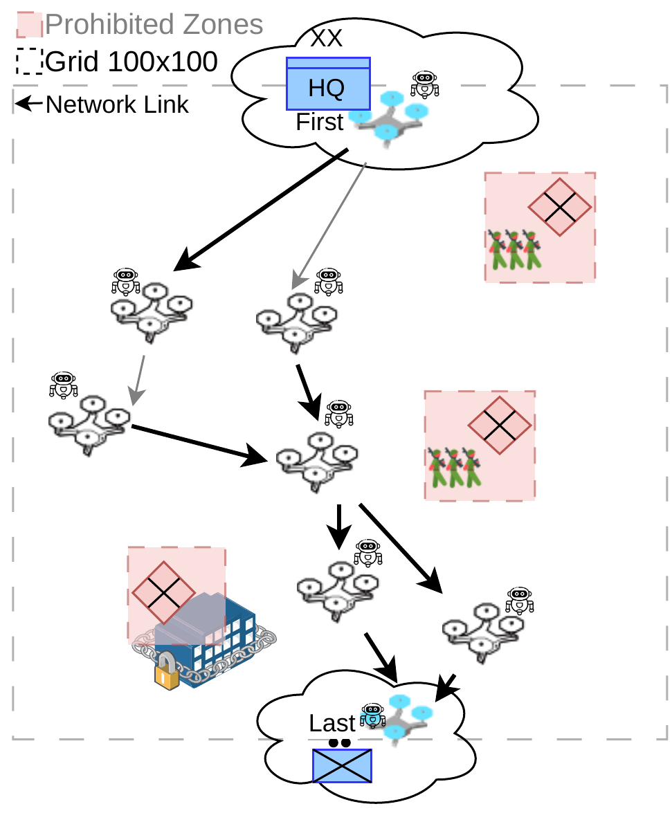

# MADPR — Multi-Agent Drone Positioning and Routing

MADPR now keeps two independent multi-agent research pipelines side by side: the original RLlib/PPO baseline and the HAPPO model supplied with a richer MAC/PHY link evaluator. Each has its own entry point, environment, dependencies, outputs, and checkpoint format. See [Model paths](docs/MODELS.md) before choosing which one to run.



*Figure 1 — Workflow supplied with the original project. The source PDF is preserved in [`img/source/WorkFlowMilcom2.pdf`](img/source/WorkFlowMilcom2.pdf).*



*Figure 2 — Multi-agent scenario supplied with the original project. The source PDF is preserved in [`img/source/Multi-agent-Scenario1.pdf`](img/source/Multi-agent-Scenario1.pdf).*

## Choose a model

| Model path | Main entry point | Propagation / link evaluation | Trainer | Dependencies |
| --- | --- | --- | --- | --- |
| **Original baseline (Free Space path)** | [`src/rl/5GMLMA.py`](src/rl/5GMLMA.py) | [`calculaProbLink_otimizado.py`](src/rl/calculaProbLink_otimizado.py); original reliability formulation | Ray RLlib PPO | Root [`requirements.txt`](requirements.txt) |
| **HAPPO + MAC/PHY** | [`src/rl/macphy/5GMLMA_MA.py`](src/rl/macphy/5GMLMA_MA.py) | Rician A2A link model plus multi-path, 802.11 contention/backoff, and M/M/1/K queue evaluation in [`abreu_modified.py`](src/rl/macphy/abreu_modified.py) | Native PyTorch HAPPO | [`src/rl/macphy/requirements.txt`](src/rl/macphy/requirements.txt) |

The `src/rl/` files have not been replaced or renamed. The HAPPO/MAC-PHY implementation lives in `src/rl/macphy/`, so the two environments and their local imports remain isolated. Their observations, actions, metrics, and checkpoints are not interchangeable.

> **Propagation terminology.** The original path is referred to as the Free Space baseline in the project context. In the supplied `calculaProbLink_otimizado.py`, however, the reference loss is Friis-based and the defaults also include a path-loss exponent of 2.3 and 4 dB log-normal shadowing; it is therefore not a pure Friis-only calculation. The new path uses the separate `LinkModelParams` implementation and MAC/PHY evaluator. See [the model comparison](docs/MODELS.md) for the distinction and reproducibility cautions.

## Installation

Use separate virtual environments to avoid dependency conflicts between the Ray/RLlib baseline and the pinned PyTorch HAPPO environment.

**Original RLlib/PPO baseline** (from the repository root):

```bash
python3 -m venv .venv-free-space
source .venv-free-space/bin/activate
python -m pip install --upgrade pip
pip install -r requirements.txt
```

**HAPPO + MAC/PHY** (from the repository root):

```bash
python3 -m venv src/rl/macphy/.venv
src/rl/macphy/.venv/bin/python -m pip install --upgrade pip
src/rl/macphy/.venv/bin/python -m pip install -r src/rl/macphy/requirements.txt
```

Python 3.11 or 3.12 is recommended for the HAPPO/MAC-PHY snapshot. Detailed dependency and validation notes are in [`docs/INSTALLATION.md`](docs/INSTALLATION.md).

## Run the original baseline

Activate `.venv-free-space`, then run from `src/rl` so the baseline's local module imports resolve:

```bash
cd src/rl
python 5GMLMA.py --timesteps 100000 --num-gpus 0
```

The trainer uses Ray RLlib PPO, with an `anchor` policy and a shared `inter` policy. Its output and resume instructions remain in [`docs/USAGE.md`](docs/USAGE.md).

## Run HAPPO + MAC/PHY

The HAPPO launcher now resolves its paths from its own directory and can be called from the repository root. The default command starts the automatic curriculum in the background and may consume substantial compute:

```bash
bash src/rl/macphy/start.sh
```

To run one manual block in the foreground instead:

```bash
CURRICULUM=0 BLOCK_FOREGROUND=1 bash src/rl/macphy/start.sh
```

For the native trainer's command-line options:

```bash
src/rl/macphy/.venv/bin/python src/rl/macphy/5GMLMA_MA.py --help
```

Runtime results are isolated under `src/rl/macphy/results/`; best-model files are under `src/rl/macphy/ppo_best_model/` by default. The original baseline retains its separate `src/rl/marl_workdir/` and `src/rl/ppo_best_model/` outputs.

## Repository map

```text
MADPR/
├── src/rl/                          # Original Free Space / RLlib PPO path
│   ├── 5GMLMA.py
│   ├── drone_env_multi.py
│   └── calculaProbLink_otimizado.py
├── src/rl/macphy/                   # HAPPO + MAC/PHY path
│   ├── 5GMLMA_MA.py                 # Native PyTorch HAPPO trainer
│   ├── drone_env_multi_abreu.py     # Environment and multi-agent wrappers
│   ├── abreu_modified.py            # Propagation, MAC/PHY, queues and paths
│   ├── start.sh                     # Curriculum / block launcher
│   ├── requirements.txt             # Separate dependency manifest
│   ├── README.md
│   └── legacy/                      # Archived, non-compatible Optuna script
├── docs/
│   ├── MODELS.md                    # Which model to use and how they differ
│   ├── INSTALLATION.md
│   ├── USAGE.md
│   ├── ARCHITECTURE.md
│   ├── COMPARISON.md
│   └── SOURCE_AUDIT.md
├── img/
├── requirements.txt                # Original RLlib/PPO dependencies
└── README.md
```

## Documentation

- [Model paths and technical comparison](docs/MODELS.md)
- [Installation and separate environments](docs/INSTALLATION.md)
- [Execution, outputs, and checkpoints](docs/USAGE.md)
- [Architecture of both pipelines](docs/ARCHITECTURE.md)
- [Comparison with iDPR](docs/COMPARISON.md)
- [Source audit and validation boundary](docs/SOURCE_AUDIT.md)
- [HAPPO/MAC-PHY local guide](src/rl/macphy/README.md)

## Research and reproducibility notes

The repository contains implementations and configuration interfaces, not a benchmark result table or trained checkpoints. The additional MAC/PHY detail should not be treated as evidence of better performance or validated propagation accuracy without calibration and controlled experiments. For a comparison, align scenario geometry, radio settings, traffic, zone layout, initialization, compute budget, and random seeds; report the selected code path and dependency versions with each result.

The two trainers create incompatible checkpoint formats. Do not try to load a `.pt` HAPPO checkpoint with RLlib or an RLlib checkpoint with the native HAPPO trainer. Runtime logs, environments, result folders, and checkpoints are intentionally excluded from version control.

## License

This project is distributed under the MIT License. See [`LICENSE`](LICENSE).

## References

[1]: https://docs.ray.io/en/latest/rllib/multi-agent-envs.html "Ray RLlib multi-agent environments"
[2]: https://docs.ray.io/en/latest/rllib/algorithms/ppo/ "Ray RLlib PPO"
[3]: https://gymnasium.farama.org/api/env/ "Gymnasium environment API"
[4]: https://pytorch.org/docs/stable/ "PyTorch documentation"


## Documentação em português

A versão em português deste guia, com seleção dos modelos e comandos de instalação/execução, está em [`README.pt-BR.md`](README.pt-BR.md). O comparativo técnico em português está em [`docs/MODELOS.md`](docs/MODELOS.md).
